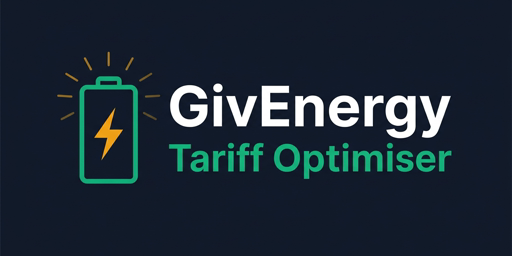
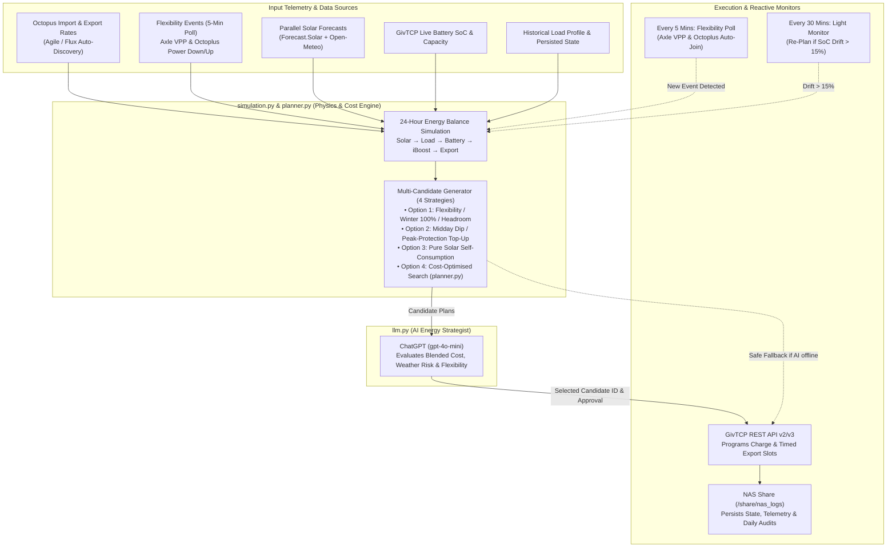
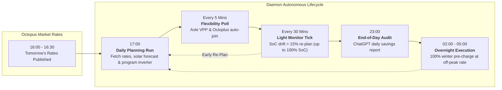
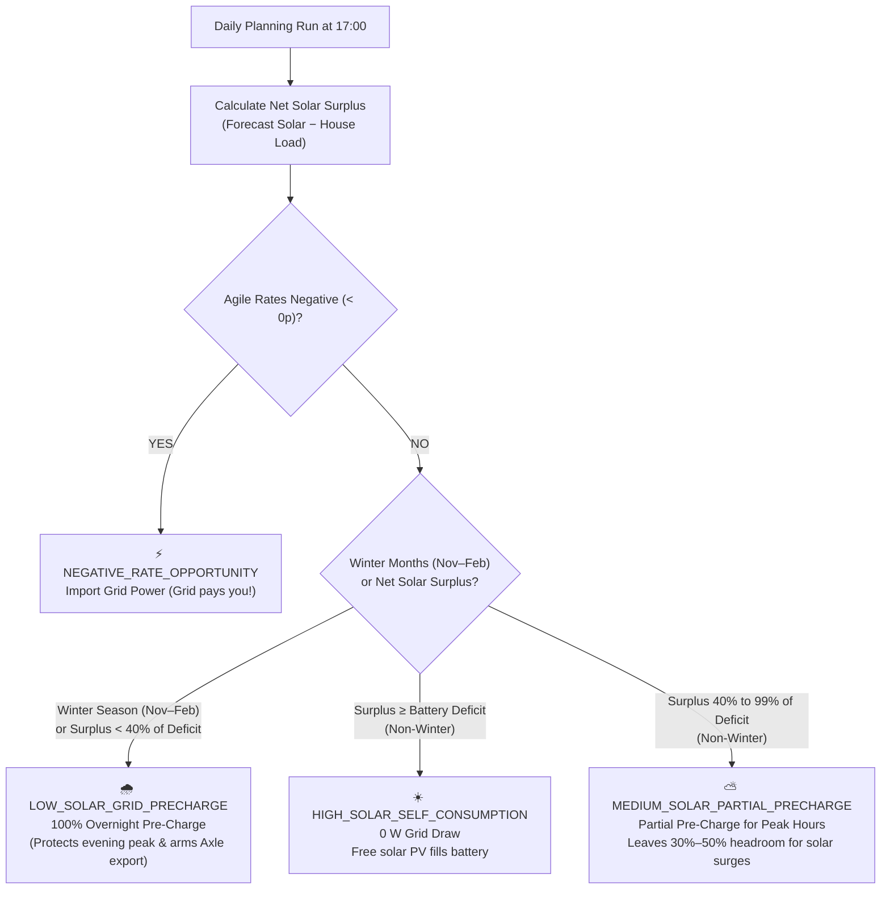

<p align="center">
  
</p>

# ⚡ GivEnergy Tariff Optimiser

A Home Assistant App that automatically schedules your GivEnergy battery to charge during the cheapest **Octopus Agile** or **Octopus Flux** half-hour slots, taking into account your solar forecast, flexibility events (Axle VPP & Octoplus), and current battery state of charge.

> **Designed for:** **Octopus Agile** and **Octopus Flux** tariff customers (import & export, auto-discovered via Octopus Account API) with GivEnergy inverters and solar panels running Home Assistant.

---

## 📖 Documentation Quick Links

| Guide | Description | Target Audience |
| :--- | :--- | :--- |
| 🛠️ [**Setup & Installation Guide**](SETUP.md) | Step-by-step setup, configuration options, prerequisites, and first-run checklist | New Installations & Setup |
| 📘 [**End-User Guide & Operations**](ha-addon/DOCS.md) | How charging works, candidate strategies, daily savings, washing machine dashboard | Daily Home Users |
| ☀️ [**Solar & Weather Strategy**](ha-addon/ARBITRAGE_AND_WEATHER.md) | Weather-adaptive day classification, autumn headroom, and export arbitrage | Solar & Energy Enthusiasts |
| 📐 [**Architecture & Technical Specification**](ha-addon/SPECIFICATION.md) | Component architecture, Pydantic contracts, OpenAPI 3.1.0 spec, and contract test suite | Developers & Integrators |
| 🧪 [**Testing, Guardrails & Mutation QA**](ha-addon/TESTING.md) | Testing pyramid, 5 E2E guardrails, mutation testing scoreboard, and CI verification | Developers & QA |
| 📜 [**Changelog & Releases**](ha-addon/CHANGELOG.md) | Version history and senior developer reviews | Release Tracking |

---

## ✨ Features

- 🔋 **Reads live battery SoC** via GivTCP REST API v2/v3 (falls back to direct Modbus TCP)
- ☀️ **Dual parallel solar forecasting** — Forecast.Solar API primary + [Open-Meteo Solar API](https://open-meteo.com) shadow provider with real-time accuracy logging
- ⚡ **Octopus Agile & Flux rate fetching** — auto-discovers your active import & export tariffs via the Octopus Account API and pulls all upcoming 30-minute pricing slots
- 💱 **Live & Time-of-Use Octopus export rates** — supports Outgoing Fixed/Variable and time-of-use Flux Export so arbitrage self-adjusts slot-by-slot
- 📊 **24-hour simulation & dynamic load profiling** — models battery/solar/load with half-hour telemetry history & hourly baseline profiles
- 🛡️ **Octopus Octoplus Power Down protection** — enforces 0.0 kWh grid import during Power Down sessions and pre-charges battery at cheaper earlier rates
- 🎯 **Arbitrage-aware & Octoplus optimiser** — charges from grid whenever import < export rate (after ~90% round-trip efficiency), or during free Octoplus sessions
- 🧠 **Smart cheapest slot search** — evaluates both contiguous and non-contiguous cheapest slot combinations across the day
- 🤖 **Smart ChatGPT plan validator** — evaluates pre-charge economics vs peak import rates avoided; produces plain-English daily audit reports
- ⚡ **5-Minute Continuous Flexibility Polling** — polls **Axle Energy VPP** and **Octopus Octoplus** every 5 minutes to auto-enroll Power Down sessions, detect confirmed Happy Hours, and arm Axle `Timed Export` just-in-time (within 10 minutes of dispatch) so `Eco` mode covers peak & Power Down
- 🔄 **30-Minute Dynamic SoC Drift Re-Planning** — periodic 30-minute light monitor tick checks live SoC against planned schedule, triggering immediate re-planning if drift > `15.0%` (up to `100%` daytime SoC when needed to protect evening peak & Power Down windows)
- ❄️ **Winter 100% Overnight Pre-Charge Policy** — automatically fills the battery to `100%` during cheap overnight windows (Nov–Feb) to eliminate daytime peak imports and arm Axle VPP exports
- 🧩 **Flattened Modular Architecture** — clean separation into `givtcp.py`, `tariffs.py`, `solar.py`, `solar_openmeteo.py`, `planner.py`, `octoplus.py`, `axle.py`, `rewards.py`, `profiler.py`, and `llm.py`
- 📋 **Technical Specification & Contract Testing** — formal [`SPECIFICATION.md`](ha-addon/SPECIFICATION.md) and API contract test suite (`tests/test_contracts.py`)
- 🏷️ **Single-Source Versioning** — `version.py` (`__version__`) synced automatically with `config.yaml`, `openapi.json`, and `SPECIFICATION.md` (enforced by `scripts/verify_commit.py`) to ensure zero version drift
- 🏠 **Native Home Assistant App** — installs directly from a local repository

---

## 🏗️ Architecture

For complete API contracts, component specifications, and Mermaid sequence diagrams, see [`ha-addon/SPECIFICATION.md`](ha-addon/SPECIFICATION.md).

```
GivEnergy_Tracker/
├── ha-addon/                      ← The Home Assistant App package
│   ├── version.py                 ← Single source of truth for version (__version__)
│   ├── config.yaml                ← App manifest (name, version, options)
│   ├── Dockerfile                 ← Builds the App container (python:3.11-slim)
│   ├── run.sh                     ← Entrypoint: reads HA options, launches optimiser
│   ├── config.py                  ← Real credentials & settings
│   ├── optimiser.py               ← Main daemon orchestrator & scheduling loop
│   ├── simulation.py              ← 24-hour deterministic physical energy balance simulation
│   ├── planner.py                 ← Cost-based plan simulator and target-SoC search
│   ├── givtcp.py                  ← GivTCP REST API v2/v3 & Modbus TCP integration
│   ├── tariffs.py                 ← Octopus Agile & Outgoing export rates fetcher & account auto-discovery
│   ├── solar.py                   ← Forecast.Solar API client & parallel ensemble manager
│   ├── solar_openmeteo.py         ← Open-Meteo Solar API client (shadow provider)
│   ├── octoplus.py                ← Octoplus Power Down & Power Up session detection & auto-join
│   ├── axle.py                    ← Axle Energy Virtual Power Plant (VPP) Self-Dispatch client
│   ├── rewards.py                 ← Wheel of Fortune auto-spins & Monday scratchcard alerts
│   ├── appliance.py               ← Washing machine & smart plug telemetry tracking
│   ├── state.py                   ← NAS state persistence & rolling telemetry history
│   ├── profiler.py                ← Dynamic load profiling & half-hourly history
│   ├── llm.py                     ← ChatGPT AI candidate selection & daily audit reporter
│   ├── contracts.py               ← Pydantic v2 data models & validation schemas
│   ├── hive.py                    ← Decoupled Hive hot water controller integration
│   ├── tracker.py                 ← Lightweight Octopus API connection probe
│   ├── translations/              ← Home Assistant UI localization & descriptive subtitles
│   │   └── en.yaml                ← Full configuration titles and inline option descriptions
│   ├── requirements.txt           ← Python dependencies
│   ├── icon.png & logo.png        ← Home Assistant App icon & banner
│   ├── ARCHITECTURE.md            ← Modular domain & composable pipeline guide
│   ├── SPECIFICATION.md           ← Complete technical specification & architecture
│   ├── TESTING.md                 ← Testing pyramid, E2E guardrails & mutation QA
│   ├── CHANGELOG.md               ← Version history & senior developer reviews
│   └── DOCS.md                    ← App user documentation
├── tests/                         ← Pytest test suite (213 unit, contract & E2E tests)
├── README.md
├── SETUP.md
├── LICENSE
└── .gitignore
```

### 🔄 Daily Data Flow Architecture



---

### 🏛️ Modular Domain Architecture

```mermaid
graph TD
    subgraph Core ["Core Orchestration"]
        OPTIMISER["optimiser.py (Daemon Orchestrator)"]
    end

    subgraph Domain ["Domain Modules"]
        CONTRACTS["contracts.py (Pydantic v2 Models)"]
        STATE["state.py (State & Daily Stats)"]
        SIMULATION["simulation.py (24h Simulation Engine)"]
        PLANNER["planner.py (Cost-Optimised Search)"]
        OCTOPLUS["octoplus.py (Octoplus Sessions & Auto-Join)"]
        AXLE["axle.py (Axle Self-Dispatch VPP)"]
        REWARDS["rewards.py (Wheel of Fortune & Scratchcard)"]
        APPLIANCE["appliance.py (Washing Machine Telemetry)"]
        PROFILER["profiler.py (Dynamic Load Profiling)"]
        HIVE["hive.py (Hive Hot Water Controller)"]
    end

    subgraph External ["External Services & Integrations"]
        GIVTCP["givtcp.py (GivTCP REST & Inverter Communication)"]
        TARIFFS["tariffs.py (Octopus Agile & Flux API)"]
        SOLAR["solar.py (Forecast.Solar & Open-Meteo Ensemble)"]
        LLM["llm.py (ChatGPT LLM Candidate Selection)"]
    end

    OPTIMISER --> CONTRACTS
    OPTIMISER --> STATE
    OPTIMISER --> SIMULATION
    OPTIMISER --> PLANNER
    OPTIMISER --> OCTOPLUS
    OPTIMISER --> AXLE
    OPTIMISER --> REWARDS
    OPTIMISER --> APPLIANCE
    OPTIMISER --> PROFILER
    OPTIMISER --> HIVE
    OPTIMISER --> GIVTCP
    OPTIMISER --> TARIFFS
    OPTIMISER --> SOLAR
    OPTIMISER --> LLM
```



---

### ⏰ Daily Execution Timeline



| Cadence / Time | Component | Action |
| :--- | :--- | :--- |
| **16:00 – 16:30** | Octopus Energy API | Tomorrow's half-hourly rates published. |
| **17:00** | Daily Planning Run | Ingests rates, solar ensemble & load profile; evaluates 4 candidate strategies; programs GivTCP registers. |
| **Every 5 Mins** | Continuous Flexibility Poll | Polls Axle Energy VPP & Octopus Octoplus; auto-enrolls Power Down events, detects booked Happy Hours, and arms Axle Timed Export 10m before dispatch. |
| **Every 30 Mins** | Light Monitor Tick | Checks live battery SoC vs. planned schedule; triggers daytime re-plan (up to 100% SoC if needed) if drift exceeds 15%. |
| **23:00** | End-of-Day Audit | ChatGPT analyzes daily solar performance, battery utilization, and net financial savings. |
| **02:00 – 05:00** | Overnight Execution | GivEnergy battery charges at low off-peak rates (15.6p/kWh on Flux; 100% target in Nov–Feb winter months). |

---

### 🌤️ Weather-Adaptive Solar Strategy & Export Arbitrage

For full technical details, see the dedicated [Weather-Adaptive Solar Strategy & Arbitrage Guide](ha-addon/ARBITRAGE_AND_WEATHER.md) subpage.



---

### 🚀 Future Hardware Roadmap & Planned Enhancements

The App currently features software simulation and fail-safe logic for heating and hot water. Physical hardware controls will be enabled once hardware installation is finalized:

- **⚡ Direct iBoost Hardware Relay Override (Planned)**: Physical smart relay integration (e.g. Shelly / ESPHome relay contact) to programmatically override the iBoost controller during negative/plunge electricity rate slots (< 0.0p/kWh), forcing 3 kW immersion heating from cheap/negative grid power even when solar PV generation is 0 W.
- **🌡️ Hot Water Cylinder Temperature Sensors (Planned)**: Installation of multi-point 1-Wire DS18B20 or Zigbee cylinder probes (top/middle/bottom) to measure exact thermal stratification (°C) and stored thermal energy (kWh). When missing, `evaluate_morning_shower_safety(tank_temp_c)` defaults to `SAFE` mode (keeping Hive gas boiler on `"schedule"`) to guarantee a 6:00 AM warm shower.

---

## ⚙️ Configuration Options Quick Reference

| Option | Default | Required? | First-Time User Guidance |
| :--- | :---: | :---: | :--- |
| **`interval_minutes`** | `30` | Yes | **Leave as `30`**. Wakeup check interval matching Octopus 30-minute tariff slots. |
| **`run_once`** | `false` | No | **Leave as `false`**. When `true`, runs 1 test pass then stops. Keep `false` for 24/7 background mode. |
| **`debug_logging`** | `false` | No | **Leave as `false`**. Keeps logs clean and concise. Set to `true` for verbose HTTP troubleshooting. |
| **`openai_api_key`** | `""` | Optional | **OpenAI API Key** (`sk-...`). Enables ChatGPT plan scoring & daily audit report. Optional. |
| **`openai_model`** | `gpt-4o-mini` | Optional | **AI Model Selection**. Default (`gpt-4o-mini`) is cheap (< 1p/month), fast, and accurate. |
| **`daily_plan_hour`** | `17` | Yes | **Daily Planning Hour (5:00 PM)**. Octopus publishes rates at 16:30, programming inverter 7h early. |
| **`daily_audit_hour`** | `23` | Yes | **Daily Audit Hour (11:00 PM)**. Summarizes today's financial performance right before midnight. |
| **`enable_winter_full_charge`** | `true` | Optional | **Winter 100% Pre-Charge (Nov–Feb)**. Automatically fills to 100% during cheap off-peak hours in winter. |

---

## 📋 Prerequisites

| Component | Requirement |
|-----------|------------|
| Home Assistant | 2024.1+ with Supervisor |
| GivEnergy Inverter | Any model supported by GivTCP |
| GivTCP App | Installed & running in Home Assistant |
| Octopus Energy | **Octopus Agile** or **Octopus Flux** (import) + **Outgoing Fixed/Variable** or **Flux Export** (auto-discovered via API key) |
| Solar Panels | With known kWp, tilt (declination), and azimuth |
| Network Share (Optional) | For persistent log files (NAS, Samba, etc.) |

### Home Assistant resources

If you're new to Home Assistant or the App system:

- 🏠 [Home Assistant website](https://www.home-assistant.io/) — official project home
- 🚀 [Getting started guide](https://www.home-assistant.io/getting-started/) — installation, first-boot onboarding, device integration
- 📦 [Apps overview](https://www.home-assistant.io/addons/) — how HA's App system works
- 🛠️ [Local App tutorial (developer docs)](https://developers.home-assistant.io/docs/add-ons/tutorial/) — the mechanics of installing a local repository
- 🔌 [GivTCP](https://github.com/britkat1980/giv_tcp) — the community App that talks to GivEnergy inverters (prerequisite for this tracker)
- ⚡ [Octopus Energy Developer API](https://developer.octopus.energy/) — where your API key lives

---

## 🚀 Installation & Sharing

### Adding to Home Assistant (1-Click Badge)

Click the button below to add this repository directly to your Home Assistant Apps:

[](https://my.home-assistant.io/redirect/supervisor_add_addon_repository/?repository_url=https%3A%2F%2Fgithub.com%2Frevhawk%2FGivEnergy_Tracker)

### Manual Repository Installation

Any Home Assistant user can add this repository by following these steps:

1. In Home Assistant, go to **Settings → Apps → Install app** (bottom-right button).
2. In the top-right corner, click **⋮ (three dots) → Repositories**.
3. Add the GitHub repository URL:
   ```text
   https://github.com/revhawk/GivEnergy_Tracker
   ```
4. Click **Add**. The **GivEnergy Tariff Optimiser** card will appear in the **App list**!
5. Click **Install**, configure options under the **Configuration** tab, and click **Start**.

---

### Local Development Installation (Alternative)

1. Copy the `ha-addon/` directory into your Home Assistant host's `/addons/givenergy_tracker/` folder using either:
   - **Samba share** — mount `\\homeassistant\addons\` from your desktop and copy the folder in.
   - **Terminal / SSH App** — `scp` or `git clone` directly onto the Pi.
2. In Home Assistant: **Settings → Apps → Install app**. The **GivEnergy Tariff Optimiser** card will appear under **Local apps**.
3. If you don't see it, click **⋮ (top right) → "Check for updates"** — that forces HA to re-scan the local App folder.

### 2. Configure `config.py`

Before installing, populate `ha-addon/config.py` on the HA host with your credentials.
Copy from the template:

```bash
cp config.py.example config.py
```

Then edit `config.py` with your Octopus API key, MPANs, meter serial, geographic coordinates, and battery/solar hardware settings (see [Configuration Reference](#-configuration-reference) below).

> ⚠️ **`config.py` is listed in `.gitignore`** and will never be committed to Git. It contains your API keys and passwords. Treat it as a secret file — do not paste its contents into chat logs, forums, or LLM sessions.

### 3. Install & Start

1. Click **Install** on the App card
2. Go to the **Configuration** tab and set your options (`interval_minutes`, `openai_api_key`, `daily_plan_hour`, `daily_audit_hour`, `enable_axle_dispatch`)
3. Click **Start**
4. Watch the **Log** tab. On first startup you should see:
   - Version banner: `GivEnergy Tariff Optimiser v1.0.25.11`
   - Effective config dump (verifies your `config.py` values)
   - First planning run (`===== DAILY PLANNING RUN (first plan since startup) =====`)

### 4. Updating to a newer version

After you edit any file on the HA host (either by editing directly or SMB-copying new versions):

1. Bump `version:` in `ha-addon/config.yaml` AND `__version__` in `ha-addon/version.py` (they must match)
2. **Reload the App list** — Settings → Apps → **Install app** → ⋮ → **Check for updates** (or click the **↻** refresh icon on the Apps page). This is the step most easily forgotten — HA caches version metadata and won't detect the change without this refresh.
3. Click **Update** on the App card (or ⋮ → **Rebuild** if you want to force a fresh image build)
4. Confirm the log banner shows the new version `v1.0.25.11`

---

## ⚙️ Configuration Reference

### Home Assistant Options (via UI)

| Option | Type | Default | Description |
|--------|------|---------|-------------|
| `interval_minutes` | int | `30` | Daemon wake-up cadence. Full re-plan fires once per day; other ticks are cheap SoC-only reads. |
| `run_once` | bool | `false` | Exit after one planning pass (useful for testing) |
| `openai_api_key` | str | `""` | OpenAI API key. Enables plan scoring/veto and end-of-day audit. |
| `openai_model` | dropdown | `"gpt-4o-mini"` | OpenAI model selector (`gpt-4o-mini`, `gpt-4o`, `gpt-3.5-turbo`) |
| `daily_plan_hour` | int | `17` | Local hour to fire the daily planner (typically after Octopus publishes tomorrow's rates) |
| `daily_audit_hour` | int | `23` | Local hour to fire the end-of-day audit |
| `log_file_path` | str | `"/share/nas_logs/givenergy_tracker.log"` | Network / SMB path for timestamped logs and daily performance history (`/share/nas_logs/history/`) |

### `config.py` Settings

```python
# ─── Inverter ───────────────────────────────────────────────────────────────
INVERTER_IP    = "192.168.1.xx"   # Static IP of your GivEnergy inverter
INVERTER_PORT  = 8899             # Modbus TCP port (usually 8899 or 502)

# ─── GivTCP ─────────────────────────────────────────────────────────────────
GIVTCP_URL     = "http://192.168.1.xx:6345"   # GivTCP REST API URL
                                               # Set to None to force Modbus only

# ─── Octopus — Import (Agile) ───────────────────────────────────────────────
OCTOPUS_API_KEY    = "sk_live_xxxxxxxxxxxx"
OCTOPUS_ACCOUNT_ID = "A-XXXXXXXX"
ELEC_IMPORT_MPAN   = "1419xxxxxxxxx"          # Import meter point (Agile)
ELEC_SERIAL        = "19Kxxxxxxxx"            # Shared serial for both directions
AGILE_PRODUCT_CODE = "AGILE-24-10-01"
AGILE_TARIFF_CODE  = "E-1R-AGILE-24-10-01-E"  # Change final letter for your region

# ─── Octopus — Export (Outgoing Variable) ───────────────────────────────────
ELEC_EXPORT_MPAN       = "1470xxxxxxxxx"      # Export meter point
EXPORT_PRODUCT_CODE    = "OUTGOING-VAR-24-10-26"
EXPORT_TARIFF_CODE     = "E-1R-OUTGOING-VAR-24-10-26-E"
EXPORT_RATE_P_FALLBACK = 12.0                 # Used only if live fetch fails
ARBITRAGE_MARGIN_P     = 0.5                  # Import must be below (export − margin)
                                              # for arbitrage to fire

# ─── Solar Array ─────────────────────────────────────────────────────────────
LATITUDE          = 52.7073   # Your home latitude
LONGITUDE         = -2.7553   # Your home longitude
SOLAR_DECLINATION = 35        # Panel tilt in degrees (0 = flat, 90 = vertical)
SOLAR_AZIMUTH     = 0         # 0 = South, -90 = East, +90 = West
SOLAR_KWP         = 10.0      # Total array capacity in kWp

# ─── Battery ─────────────────────────────────────────────────────────────────
BATTERY_CAPACITY_KWH     = 9.5    # Usable battery capacity in kWh
MAX_BATTERY_CHARGE_RATE  = 3000   # Max charge rate in Watts

# ─── Home Load ───────────────────────────────────────────────────────────────
BASE_LOAD_W             = 1000   # Baseline home consumption in Watts. Set from
                                 # your true overnight draw — under-estimating
                                 # causes the tracker to skip needed charges.
IBOOST_MAX_DIVERT_RATE  = 3000   # Solar iBoost immersion heater diversion cap (W)

# ─── Logging ─────────────────────────────────────────────────────────────────
LOG_FILE_PATH = "/share/nas_logs/givenergy_tracker.log"   # NAS mount path
LOG_LEVEL     = "INFO"   # DEBUG | INFO | WARNING | ERROR

# ─── Optional: OpenAI ────────────────────────────────────────────────────────
OPENAI_API_KEY = ""   # Leave blank to disable ChatGPT scoring/veto/audit
```

---

## 🧠 How the Optimiser Works

The daemon runs continuously in the background using **four coordinated execution modes** across a dual-cadence loop (**5-minute flexibility polling** sliced inside the **30-minute monitor interval**):

### 1. Daily Planner (once/day at `daily_plan_hour`, default 17:00)

1. **Auto-Discover & Fetch Tariffs (`tariffs.py`)** — queries your Octopus Account API to auto-detect active **Agile** or **Flux** import and **Outgoing / Flux** export tariffs, pulling all upcoming 48 half-hour slots.
2. **Fetch Dual Solar Forecasts (`solar.py`)** — retrieves **Forecast.Solar** (primary) and **Open-Meteo** (shadow) in parallel, logging forecast spread for weather-risk awareness.
3. **Overlay Flexibility Events (`axle.py`, `octoplus.py`)** — checks active **Axle Energy VPP** dispatch windows, **Octoplus Power Down** Saving Sessions (enforcing 0.0 kWh grid import), and confirmed (`is_joined: True`) **Power Up / Happy Hour** bookings.
4. **Read Live Telemetry (`givtcp.py`)** — reads battery SoC, PV generation, and home load via GivTCP REST API v2/v3 (Modbus TCP fallback).
5. **Simulate 24h & Generate 4 Candidate Strategies (`simulation.py`, `planner.py`)** — models Solar → Dynamic Load Profile (`profiler.py`) → Battery → iBoost → Grid Export/Import, then evaluates 4 candidate plans under blended normal/pessimistic solar assumptions:
   - **Option 1 — Flexibility / Winter 100% / Headroom**: Pre-charges to 100% for Axle VPP exports or during Nov–Feb winter months, or preserves solar headroom in spring/summer.
   - **Option 2 — Midday Dip / Peak-Protection Top-Up**: Covers evening peak demand and Power Down sessions, allowing daytime re-plans up to `100%` SoC (`DAYTIME_TOPUP_MAX_TARGET_SOC`) when required.
   - **Option 3 — Pure Solar Self-Consumption**: Zero grid draw when solar surplus covers battery deficit.
   - **Option 4 — Cost-Optimised Search (`planner.py`)**: Pure side-effect-free search across contiguous and non-contiguous slots to minimize net 24h cost.
6. **AI Strategist Selection (`llm.py`)** — if OpenAI is configured, ChatGPT scores the candidate plans, evaluates weather risk, and selects the optimal strategy (with negative-rate override and fail-open deterministic fallback).
7. **Program Inverter & Persist State (`givtcp.py`, `state.py`)** — writes charge slots to GivTCP in `Eco` mode (deferring Axle `Timed Export` until 10 minutes before dispatch so battery covers peak and Power Down windows) and saves the planned SoC trajectory to `/share/nas_logs/givenergy_state.json`.

### 2. Continuous Flexibility Poll (every 5 minutes)

The 30-minute sleep interval is sliced into 5-minute ticks (`AXLE_POLL_INTERVAL_SECONDS = 300`). Every 5 minutes, the daemon polls both **Axle Energy VPP** (`check_axle_events`) and **Octopus Octoplus** (`check_octoplus_events`):
- Automatically enrolls your account in newly announced intraday **Octoplus Power Down** sessions via Kraken GraphQL / Home Assistant service.
- Detects newly booked **Happy Hour / Power Up** slots (`is_joined: True`) and short-notice **Axle VPP** export events.
- Breaks the sleep loop early to trigger an immediate re-plan (`run_optimization()`) so the inverter reacts within minutes.

### 3. Light Status & Drift Monitor (every 30 minutes)

Reads live battery SoC from GivTCP and compares it against the scheduled simulation trajectory:
- If everything is on track, logs status quietly with zero inverter writes or unnecessary API calls.
- If live SoC drifts by more than `15.0%` (`SOC_DRIFT_THRESHOLD_PCT`), triggers an immediate re-plan (daytime top-ups between 07:00 and 16:00 can target up to `100%` SoC when needed to carry through the 16:00–19:00 peak and any Power Down window).

### 4. End-of-Day Audit (once/day at `daily_audit_hour`, default 23:00)

Loads the day's plan snapshot and actual telemetry stats, then sends the context to ChatGPT for a plain-English financial savings verdict and tuning insights, archiving the result to `/share/nas_logs/history/daily_stats_YYYY-MM-DD.json`.

### Cost & Arbitrage Model

- **Import cost** = `charge_kwh × avg_slot_price` (supports dynamic Agile rates and 3-tier Flux rates)
- **Export income** = live slot-by-slot Outgoing Fixed/Variable or time-of-use Flux Export rate
- **Round-trip battery efficiency** ≈ `90%`, with **arbitrage margin** (`ARBITRAGE_MARGIN_P`, default `0.5p`) preventing marginal trades
- **Negative-rate override** — unconditionally fills battery whenever import rate `< 0.0p/kWh` (grid pays you to charge)

---

## 🔌 GivTCP Connectivity

The optimizer supports two methods to communicate with the inverter:

| Method | How | When Used |
|--------|-----|-----------|
| **GivTCP REST API** | HTTP to `GIVTCP_URL` | Preferred (when GivTCP App is running) |
| **Direct Modbus TCP** | TCP to `INVERTER_IP:INVERTER_PORT` | Fallback (requires `givenergy-modbus` package) |

If `GIVTCP_URL` is set and reachable, REST is always tried first. Direct Modbus is only used as a fallback.

---

## 📦 Versioning

This project follows [Semantic Versioning](https://semver.org/):

| Version Range | Meaning |
|--------------|---------|
| `0.0.x` | Test builds — bug fixes and config tweaks |
| `0.x.0` | Beta builds — new features |
| `1.0.0+` | Stable production releases |

When releasing a new version, synchronize the version string across the authoritative files (verified automatically by `python scripts/verify_commit.py`):
- **`ha-addon/version.py`**: `__version__ = "x.y.z"` (single source of truth, validated at runtime on startup)
- **`ha-addon/config.yaml`**: `version: "x.y.z"` (read by Home Assistant store to prompt updates)
- **`openapi.json`**: `"version": "x.y.z"` (OpenAPI 3.1.0 schema version)
- **`ha-addon/SPECIFICATION.md`**: `**Version:** x.y.z` (technical specification header & contracts)
- **`ha-addon/CHANGELOG.md`**: `## [x.y.z] - YYYY-MM-DD` (release notes & Senior Developer Review summary)

When the version number in `ha-addon/config.yaml` is bumped, Home Assistant will show an **Update** badge on the App card — no reinstall required.

---

## 🔐 Security Notes

**`config.py` contains live credentials.** Handle it accordingly:

- It is listed in `.gitignore` and should never be committed. Rely on this only as a first line of defence — a `git add -f` still bypasses it.
- Its contents are stored **in plaintext** on the Home Assistant host and inside the running container. Anyone with SSH/terminal access to the host can read it.
- HA App options set via the UI (like `openai_api_key`) live in `/data/options.json` on the host — also plaintext, contrary to what earlier docs implied.
- **Never paste `config.py` contents into a chat log, forum post, screenshot, or LLM conversation.** Once transmitted, treat the secrets as compromised and rotate them (Octopus dashboard, OpenAI dashboard, NAS admin).
- **Rotation is cheaper than an audit.** If in doubt, rotate.

### What's in it that matters

| Secret | Blast radius if leaked |
|---|---|
| `OCTOPUS_API_KEY` | Full account access — bills, tariffs, PII |
| `OPENAI_API_KEY` | Billable API access at your expense |
| `NAS_USER` / `NAS_PASSWORD` | SMB read/write on your NAS |
| `ELEC_MPAN` / `ELEC_SERIAL` / `GAS_MPRN` | UK utility identifiers — usable for change-of-supplier fraud |
| `LATITUDE` / `LONGITUDE` | Precise home coordinates |

---

## 🛠️ Development

### First-time setup

```bash
git clone https://github.com/revhawk/GivEnergy_Tracker.git
cd GivEnergy_Tracker/ha-addon
cp config.py.example config.py
# Edit config.py with your credentials, MPANs, and site geometry
```

### Editing the App

1. Edit files under `ha-addon/`.
2. **Rebuild** the App in Home Assistant (Settings → Apps → GivEnergy Tariff Optimiser → ⋮ → **Rebuild**). Restart alone won't pick up changes because `config.py` and `optimiser.py` are baked into the container image at build time.
3. Watch the **Log** tab. The startup banner shows the effective config values so you can verify your edits took.

### Running one planning pass on demand

Set `run_once: true` in the App's Configuration tab, then Start it. It'll do a full plan, write to the inverter, and exit.

### Testing in Local Environment

To set up your local development environment and run unit tests inside a virtual environment (`.venv`):

```bash
# 1. Create virtual environment from project root
python3 -m venv .venv

# 2. Activate the virtual environment
source .venv/bin/activate

# 3. Install App & test suite dependencies
pip install -r ha-addon/requirements.txt -r tests/requirements.txt

# 4. Run the full unit test suite
pytest

# 5. Run pytest in verbose mode or run specific tests
pytest -v
pytest tests/test_optimization.py

# 6. (Optional) Run local optimizer dry-run inside .venv
python ha-addon/optimiser.py
```

Test targets, end-to-end guardrails, and mutation testing benchmarks are documented in [`ha-addon/TESTING.md`](ha-addon/TESTING.md) and [`tests/README.md`](tests/README.md).

---

## 💬 Community & Support

- 🐛 **Report a Bug / Request a Feature**: Open an issue on [GitHub Issues](https://github.com/revhawk/GivEnergy_Tracker/issues)
- 📋 **View Release Notes**: Check out the [Changelog](https://github.com/revhawk/GivEnergy_Tracker/blob/main/ha-addon/CHANGELOG.md)
- 📖 **App Documentation**: Read the full [DOCS.md](https://github.com/revhawk/GivEnergy_Tracker/blob/main/ha-addon/DOCS.md)
- 🐙 **GitHub Repository**: [revhawk/GivEnergy_Tracker](https://github.com/revhawk/GivEnergy_Tracker)

---

## 📜 Licence

This project is licensed under the GNU General Public License v3.0 (GPLv3) — see [LICENSE](LICENSE) for details.

Copyright (C) 2026 Reg Hawkins (revhawk). All derivative works and modifications must remain free and open source under the GPLv3.

---

## 🙏 Acknowledgements

- [GivTCP](https://github.com/britkat1980/giv_tcp) — excellent GivEnergy integration for Home Assistant
- [Octopus Energy Developer API](https://developer.octopus.energy/docs/api/) — free, open tariff data
- [Forecast.Solar](https://forecast.solar) — free solar generation forecasts
- [givenergy-modbus](https://github.com/dewet22/givenergy-modbus) — Python Modbus library for GivEnergy inverters
