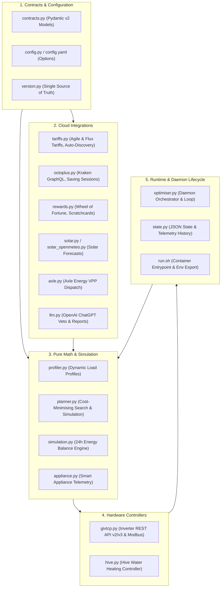

# Architecture & Domain Guide — GivEnergy Tariff Optimiser

> [!NOTE]
> This document is designed for human developers and **AI coding agents** to understand the domain boundaries, data flow, and module responsibilities across the codebase in under two minutes.

---

## 1. Domain Responsibility Matrix

The codebase in `ha-addon/` is organized into five functional layers:

| Layer | Module File | Primary Responsibility | Key Functions / Classes |
| :--- | :--- | :--- | :--- |
| **Contracts** | [`contracts.py`](file:///home/reg/Coding/GivEnergy_Tracker/ha-addon/contracts.py) | Authoritative data models (OpenAPI single source) | `InverterTelemetry`, `OctopusRateSlot`, `GivTCPWriteSlot`, `LLMVetoDecision`, `PlanResult` |
| **Configuration** | [`config.yaml`](file:///home/reg/Coding/GivEnergy_Tracker/ha-addon/config.yaml) | Add-on options schema, defaults, and permissions | `schema`, `options`, `homeassistant_api: true` |
| **Tariffs** | [`tariffs.py`](file:///home/reg/Coding/GivEnergy_Tracker/ha-addon/tariffs.py) | Dynamic import & time-of-use export rate queries | `fetch_agile_rates()`, `fetch_export_rate()`, `discover_account_tariffs()` |
| **Flexibility** | [`octoplus.py`](file:///home/reg/Coding/GivEnergy_Tracker/ha-addon/octoplus.py) | Octoplus Power Down & Power Up session handling | `fetch_live_octoplus_sessions()`, `obtain_kraken_token()` |
| **Rewards** | [`rewards.py`](file:///home/reg/Coding/GivEnergy_Tracker/ha-addon/rewards.py) | Gamification automation (Wheel of Fortune spins) | `auto_spin_available_wheels()`, `check_octoplus_scratchcard_status()` |
| **Solar** | [`solar.py`](file:///home/reg/Coding/GivEnergy_Tracker/ha-addon/solar.py) | Forecast.Solar primary & Open-Meteo parallel client | `fetch_solar_forecast()`, `fetch_parallel_solar_forecasts()` |
| **VPP** | [`axle.py`](file:///home/reg/Coding/GivEnergy_Tracker/ha-addon/axle.py) | Axle Energy Self-Dispatch Virtual Power Plant API | `fetch_axle_event()`, `is_axle_precharge_window()` |
| **Cost Planning** | [`planner.py`](file:///home/reg/Coding/GivEnergy_Tracker/ha-addon/planner.py) | Pure side-effect-free simulation & target-SoC search | `search_cheapest_plan()`, `simulate_plan_cost()` |
| **Simulation** | [`simulation.py`](file:///home/reg/Coding/GivEnergy_Tracker/ha-addon/simulation.py) | 24-hour deterministic forward physical model | `run_optimization()`, `run_light_monitor()` |
| **Load Profiling** | [`profiler.py`](file:///home/reg/Coding/GivEnergy_Tracker/ha-addon/profiler.py) | Baseline and rolling historical consumption | `get_load_kwh_for_slot()`, `is_power_down_slot()` |
| **Hardware** | [`givtcp.py`](file:///home/reg/Coding/GivEnergy_Tracker/ha-addon/givtcp.py) | Inverter telemetry reading and register programming | `read_inverter_charge_slots()`, `set_inverter_charge_slots()` |
| **AI / LLM** | [`llm.py`](file:///home/reg/Coding/GivEnergy_Tracker/ha-addon/llm.py) | OpenAI ChatGPT plan veto & daily audit reporter | `chatgpt_veto_plan()`, `generate_daily_summary()` |
| **Persistence** | [`state.py`](file:///home/reg/Coding/GivEnergy_Tracker/ha-addon/state.py) | JSON state storage, daily statistics, and logs | `load_state()`, `save_state()`, `archive_daily_stats_history()` |
| **Daemon** | [`optimiser.py`](file:///home/reg/Coding/GivEnergy_Tracker/ha-addon/optimiser.py) | Main background loop, scheduling triggers & facade | `main()`, `run_end_of_day_audit()` |

---

## 2. Core Execution Flows

### 2.1 Daily Planning Run (Scheduled 17:00 or On Startup)
1. **Rate Discovery:** [`tariffs.py`](file:///home/reg/Coding/GivEnergy_Tracker/ha-addon/tariffs.py) auto-detects active customer tariffs (Flux/Agile) and retrieves upcoming 48 half-hour slots.
2. **Solar Ensemble:** [`solar.py`](file:///home/reg/Coding/GivEnergy_Tracker/ha-addon/solar.py) fetches Forecast.Solar and Open-Meteo forecasts in parallel.
3. **Flexibility Overlay:** Checks for Octoplus Power Down events ([`octoplus.py`](file:///home/reg/Coding/GivEnergy_Tracker/ha-addon/octoplus.py)) and Axle Energy dispatch windows ([`axle.py`](file:///home/reg/Coding/GivEnergy_Tracker/ha-addon/axle.py)).
4. **Physical Simulation:** [`simulation.py`](file:///home/reg/Coding/GivEnergy_Tracker/ha-addon/simulation.py) balances Solar $\rightarrow$ Load $\rightarrow$ Battery $\rightarrow$ iBoost $\rightarrow$ Grid Export/Import.
5. **Cost Optimization Search:** [`planner.py`](file:///home/reg/Coding/GivEnergy_Tracker/ha-addon/planner.py) evaluates candidate plans under blended solar assumptions.
6. **LLM Validation:** [`llm.py`](file:///home/reg/Coding/GivEnergy_Tracker/ha-addon/llm.py) validates plan economics via ChatGPT veto.
7. **Inverter Programming:** [`givtcp.py`](file:///home/reg/Coding/GivEnergy_Tracker/ha-addon/givtcp.py) writes verified charge windows and target SoC to GivTCP registers.
8. **State Archiving:** [`state.py`](file:///home/reg/Coding/GivEnergy_Tracker/ha-addon/state.py) persists planned schedule and telemetry to disk.

### 2.2 Periodic Light Monitor Tick (Every 30 Minutes)
1. Reads live telemetry from GivTCP (battery SoC, PV power, home load).
2. Compares real-time SoC against the scheduled simulation target.
3. If drift exceeds `SOC_DRIFT_THRESHOLD_PCT` (default: 15%), triggers immediate re-planning.

### 2.3 Midnight Financial Audit (Scheduled 23:00)
1. Compares actual battery performance and home import/export against baseline.
2. Invokes ChatGPT to generate an audit report.
3. Appends historical summary to daily archive JSON in `/share/nas_logs/history/`.

---

## 3. Rules for AI Coding Agents Modifying This Codebase

1. **Maintain Single Source of Truth:**
   - Any new data structure must be defined in [`contracts.py`](file:///home/reg/Coding/GivEnergy_Tracker/ha-addon/contracts.py) as a Pydantic v2 model.
   - Version number lives solely in [`version.py`](file:///home/reg/Coding/GivEnergy_Tracker/ha-addon/version.py) and is validated on startup.
2. **Test First, Mock Cleanly:**
   - Tests live in `tests/` and use `responses` for HTTP mocking and `monkeypatch` for environment variables.
   - Never import network libraries directly in test assertions without mocking.
3. **Pre-Commit Verification:**
   - Always run `python scripts/verify_commit.py` before proposing commits. All 165+ tests must pass 100%.

