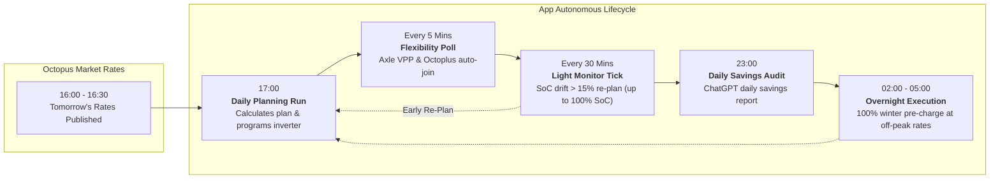
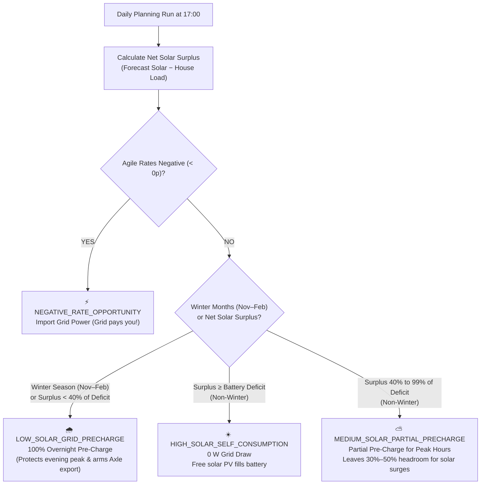

# GivEnergy Tariff Optimiser — App User Guide

Welcome to the **GivEnergy Tariff Optimiser**! This Home Assistant App automates your GivEnergy battery storage, solar PV panels, and hot water heating around your dynamic **Octopus Energy** electricity tariffs (**Octopus Agile** or **Octopus Flux** import, and **Outgoing** or **Flux Export**, with automatic account tariff discovery).

---

## 🌟 What This App Does For You

- ⚡ **Automated Overnight Pre-Charging**: Automatically charges your battery during the cheapest half-hour grid slots overnight so your home runs on cheap power during expensive day & evening peak hours.
- 💰 **Profitable Solar Arbitrage**: When electricity rates dip lower than your solar export price, the App charges your battery from cheap grid power so you can sell more of your daytime solar generation back to the grid for profit.
- 🤖 **Smart AI Plan Review**: Uses OpenAI's ChatGPT as an independent sanity check to score your daily plan out of 10 and veto any unusual charge decisions.
- 🧺 **Washing Machine Usage Dashboard**: Monitors smart plug power draw (`sensor.washing_machine_power`), tracks daily wash cycles & kWh, calculates exact wash costs in pence, and recommends the top 3 cheapest Agile windows to run laundry.
- ♨️ **Smart Hot Water & Heating Control**: Directs excess solar energy into your hot water cylinder via iBoost immersion diversion and automatically pauses your Hive gas boiler when electric/solar heating is active—saving gas while guaranteeing a warm morning shower.
- 🐙 **Octopus Octoplus Sessions (Power Up & Saving Sessions)**: Automatically detects upcoming Free Electricity windows (0.0p/kWh) to pre-charge your battery and heat hot water for free, and enforces zero grid import during Saving Sessions to maximize OctoPoints rewards.
- 🔋 **Axle Energy Virtual Power Plant**: Connects with Axle Energy Self-Dispatch mode to support the UK grid, pre-charging your battery and force-exporting during events to maximize your earnings.
- 📊 **Daily Financial Savings Audit**: Generates a daily summary every evening detailing your actual energy savings compared to standard electricity tariffs.

---

## 🚀 Quick Setup Guide

### 1. Installation

1. In Home Assistant, go to **Settings → Apps → Install app** (bottom-right button).
2. Click **⋮ (three dots) → Repositories** in the top right.
3. Add the repository URL:
   ```text
   https://github.com/revhawk/GivEnergy_Tracker
   ```
4. Find **GivEnergy Tariff Optimiser** in the **App list** and click **Install**.

### 2. Configuration Settings

Open the **Configuration** tab of the App to customize your settings:

| Setting | Recommended Default | What It Means for You |
| :--- | :---: | :--- |
| **`interval_minutes`** | `30` | **Leave as `30`**. Wake-up check cadence matching Octopus 30-minute tariff slots. |
| **`run_once`** | `false` | **Keep `false`** for 24/7 background mode. Set to `true` only if you want to run 1 test pass and exit. |
| **`debug_logging`** | `false` | **Keep `false`** for clean, easy-to-read logs. Set to `true` if you need detailed HTTP connection traces for troubleshooting. |
| **`openai_api_key`** | `""` *(Optional)* | Enter your OpenAI API key (`sk-proj-...`) to enable ChatGPT plan scoring & daily audit reports. Optional—the planner works 100% without it. |
| **`openai_model`** | `gpt-4o-mini` | Select `gpt-4o-mini` (cheap, fast, and highly accurate). |
| **`daily_plan_hour`** | `17` *(5:00 PM)* | The hour when tomorrow's charge plan is calculated. Octopus publishes rates at 16:30, so 17:00 programs your inverter 7 hours before night charging. |
| **`daily_audit_hour`** | `23` *(11:00 PM)* | The hour when your daily financial savings report is generated. |
| **`log_file_path`** | `/share/nas_logs/givenergy_tracker.log` | **NAS Log Location**. The network / SMB file path where timestamped logs and daily performance history (`/share/nas_logs/history/`) are saved. |
| **`enable_axle_dispatch`** | `false` | **Axle VPP Toggle**. Set to `true` to enable automated export during Axle Energy grid flexibility events. |
| **`axle_api_token`** | `""` | **Axle API Token**. Your token from Axle Energy Account Settings → Home Assistant. (Can also be set in `/share/givenergy_config.py`). |
| **`axle_export_power_w`** | `0` | **Axle Export Power (Watts)**. Continuous battery discharge limit during flexibility events. `0` (default) auto-detects your inverter's hardware max rate from GivTCP (e.g. `3,600 W` on Hybrid Gen 3). |
| **`enable_winter_full_charge`** | `true` | **Winter 100% Overnight Pre-Charge**. Targets 100% SoC during cheap off-peak hours (Nov–Feb) to avoid daytime/peak imports and arm Axle exports. |

---

## ⏰ How Your System Works Throughout the Day

Once installed, the App runs quietly in the background without spamming your network or inverter:



### The 4 Routine Modes:

1. **Daily Planner (Fires at 17:00)**: Fetches tomorrow's 48 Octopus import/export rates and solar forecasts, simulates 24 hours of home energy demand across 4 candidate strategies, programs optimal charge slots into your inverter via GivTCP, and pauses Hive gas boiler when appropriate.
2. **Continuous Flexibility Monitor (Every 5 mins)**: Polls **Axle Energy VPP** and **Octopus Octoplus** every 5 minutes. Automatically enrolls in newly announced Power Down sessions, detects confirmed Happy Hour bookings, arms Axle `Timed Export` 10 minutes before dispatch (keeping `Eco` mode active beforehand), and breaks the sleep loop immediately to re-plan your inverter.
3. **Light Status & Drift Monitor (Every 30 mins)**: Reads live battery SoC against the planned schedule. If SoC drifts by more than `15%`, triggers a daytime re-plan (up to `100%` target SoC when needed) to protect the evening peak and Power Down windows.
4. **Daily Savings Audit (Fires at 23:00)**: Calculates your estimated savings for the day and logs a clear ChatGPT summary report.

---

## 🌤️ Weather-Adaptive Solar Strategy & Export Arbitrage

For full architectural details, see the dedicated [Weather-Adaptive Solar & Arbitrage Guide](ARBITRAGE_AND_WEATHER.md) subpage.

The App uses a **4-Tier Day Classifier** to dynamically adapt to daily UK weather without static calendar months:



### How The App Saves You Money:

1. **Overnight & Midday Deficit Charging**: If tomorrow's solar forecast is low (`LOW_SOLAR_GRID_PRECHARGE`), the optimiser pre-charges the battery during cheap Agile slots to protect against 45p–50p peak evening rates.
2. **Medium Solar Headroom (`MEDIUM_SOLAR_PARTIAL_PRECHARGE`)**: On partial solar days, partial pre-charging covers peak demand while leaving **30%–50% top battery headroom** to capture live daytime solar surges (like a 7.1 kW solar surge when the oven is running!).
3. **High Solar Self-Consumption (`HIGH_SOLAR_SELF_CONSUMPTION`)**: On sunny days, grid charging is **suppressed (0 W grid draw)** so your battery fills 100% for free.
4. **Octopus Octoplus Sessions (Power Down & Power Up)**:
   - **Power Down Sessions (Saving Sessions)**: Enforces 0.0 kWh grid import during peak demand events and pre-charges your battery beforehand at cheaper rates.
   - **Power Up Sessions (Free Electricity)**: Automatically schedules maximum battery charging during Octopus Free Electricity sessions.
5. **Smart Hot Water Control**:
   - **Excess Solar Diversion**: Excess solar power beyond home load and battery capacity is directed into your hot water cylinder via iBoost.
   - **Gas Savings with Morning Shower Safety**: Pauses your Hive gas boiler when electric pre-charging or solar heating is active, performing a 05:00 AM temperature check (≥ 45°C) for shower safety.

---

## 🚀 Future Hardware Enhancements

The current App version includes full software simulation and fail-safe logic. Upcoming hardware integrations include:

- **⚡ Direct iBoost Immersion Relay Override**: Hardware relay contact integration to force 3 kW immersion hot water heating during negative/plunge electricity rate slots (< 0.0p/kWh).
- **🌡️ Hot Water Cylinder Temperature Probes**: Integration with 1-Wire DS18B20 or Zigbee multi-point cylinder sensors to measure exact stored thermal energy (kWh).

---

## ❓ Frequently Asked Questions & Troubleshooting

### Why is no grid charging scheduled today?
1. **Solar covers your needs**: Your solar forecast is strong enough to cover home load and fill your battery without needing grid power.
2. **Import rates are higher than export**: Every import slot is above your export arbitrage threshold, so grid charging would cost more than exporting solar.

### How do I check App logs and access NAS files?
Go to **Settings → Apps → GivEnergy Tariff Optimiser → Log** tab in Home Assistant.

For long-term storage, your App saves timestamped logs and performance history into `/share/nas_logs/`.

#### 🎛️ 1. Setting the NAS Log Location in Home Assistant UI
In the App **Configuration** tab, enter the path as a Unix-style Home Assistant container path:
- **HA UI Setting (`log_file_path`)**: `/share/nas_logs/givenergy_tracker.log` *(Default)*

#### 📂 2. Accessing NAS Files from Your PC / Mac (Windows vs Unix Style)

| Operating System / Client | Network / Folder Access Path |
| :--- | :--- |
| **🪟 Windows File Explorer** | `\\<YOUR_HA_IP>\share\nas_logs\` *(e.g. `\\homeassistant.local\share\nas_logs\`)* |
| **🐧 Linux / Unix System** | `/share/nas_logs/` or `smb://homeassistant.local/share/nas_logs/` |
| **🍎 macOS Finder** | `smb://homeassistant.local/share/nas_logs/` *(Go → Connect to Server)* |
| **🏠 Home Assistant File Editor** | Open **File Editor** App → navigate to `/share/nas_logs/` |

Files generated in your NAS directory:
- **`givenergy_tracker.log`**: Full timestamped log file (`YYYY-MM-DD HH:MM:SS - INFO - ...`).
- **`history/daily_stats_YYYY-MM-DD.json`**: Historical performance summaries and ChatGPT audit reports for each day.
- **`history/daily_stats_YYYY-MM-DD_HHMMSS.json`**: Historical performance summaries and ChatGPT audit reports saved with precise date and time stamps.
- **`givenergy_state.json`**: Rolling 14-day load profile history and planned SoC schedule.

---

## 💬 Support & Documentation

For updates, questions, or issues, visit the [GivEnergy Tracker GitHub Repository](https://github.com/revhawk/GivEnergy_Tracker):
- **Architecture & Composable Pipeline**: [`ARCHITECTURE.md`](ARCHITECTURE.md)
- **Technical Specification & Contracts**: [`SPECIFICATION.md`](SPECIFICATION.md)
- **Testing, E2E Guardrails & Mutation QA**: [`TESTING.md`](TESTING.md)
- **Weather & Arbitrage Strategy**: [`ARBITRAGE_AND_WEATHER.md`](ARBITRAGE_AND_WEATHER.md)
