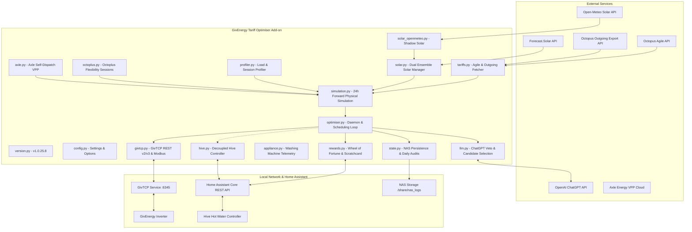
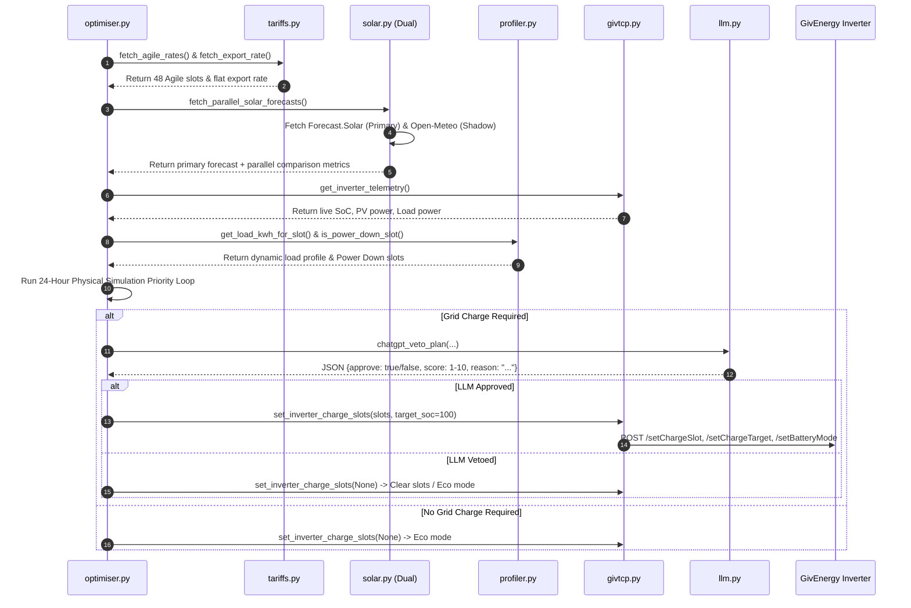
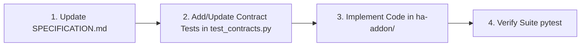

# Technical Specification & Architecture — GivEnergy Tariff Optimiser

**Version:** 1.0.25.8  
**Target Hardware:** GivEnergy Inverters (Gen 1, Gen 2, Gen 3, All-in-One)  
**Target Platform:** Home Assistant Add-on Container (Linux ARM64 / AMD64)  

---

## 1. Executive Summary & Overview

The **GivEnergy Tariff Optimiser** is an autonomous energy cost optimization engine designed for UK homes with GivEnergy battery storage, solar PV arrays, and dynamic time-of-use tariffs (e.g. Octopus Agile & Octopus Outgoing).

The system models a 24-hour forward physical simulation of home energy balance (Solar $\rightarrow$ Home Demand $\rightarrow$ Battery State of Charge $\rightarrow$ Hot Water iBoost Diversion $\rightarrow$ Grid Export/Import). It evaluates both contiguous and non-contiguous low-cost import windows, calculates optimal pre-charging for peak deficit hours and Octoplus Power Down sessions, validates plan economics via a structured LLM Veto framework (OpenAI GPT), and programs the GivEnergy inverter via GivTCP REST API v2/v3.

---

## 2. System Architecture



---

## 3. Data Flow & Optimization Sequence



---

## 4. Component Contracts & Interface Specifications

### 4.1 Single-Source Versioning Contract (`version.py`)
- **Module:** `version.py`
- **Variable:** `__version__ = "1.0.25.8"`
- **Contract:** MUST match `version:` field in `ha-addon/config.yaml`. Validated during daemon initialization.

### 4.2 GivTCP REST v2/v3 Contract (`givtcp.py`)
- **Base Endpoint:** `http://<GIVTCP_IP>:6345`
- **Endpoints Used:**
  - `GET /getCache`: Returns inverter telemetry dict containing nested keys `SOC`, `PV_Power`, `Load_Power`, `charge_slot_1`, `charge_slot_2`.
  - `POST /setChargeSlot`: Payload `{"start": "HH:MM", "finish": "HH:MM", "slot": "1".."10", "chargeToPercent": int}`.
  - `POST /setChargeTarget`: Payload `{"chargeToPercent": int}`.
  - `POST /setBatteryMode`: Payload `{"mode": "Timed Demand"}` (when charging) or `{"mode": "Eco"}` (when clearing).
  - `POST /enableChargeSchedule`: Payload `{"state": "enable"}` or `{"state": "disable"}`.

### 4.3 Octopus Energy Tariff Contract (`tariffs.py`)
- **Agile Import API:** `https://api.octopus.energy/v1/products/AGILE-24-10-01/electricity-tariffs/E-1R-AGILE-24-10-01-E/standard-unit-rates/`
- **Outgoing Export API:** `https://api.octopus.energy/v1/products/OUTGOING-VAR-24-10-26/electricity-tariffs/E-1R-OUTGOING-VAR-24-10-26-E/standard-unit-rates/`
- **Payload Contract:** JSON containing `results: [{ valid_from, valid_to, value_inc_vat }]`.

### 4.4 Dual Solar Provider Contract (`solar.py` & `solar_openmeteo.py`)
- **Primary Provider (Forecast.Solar):** `https://api.forecast.solar/estimate/{lat}/{lon}/{decl}/{azim}/{kwp}`
  - Applies `MORNING_SOLAR_DAMPING` (`0.65x`) for slots starting before 09:00 local time.
- **Secondary Provider (Open-Meteo):** `https://api.open-meteo.com/v1/forecast?latitude={lat}&longitude={lon}&hourly=global_tilted_irradiance&tilt={tilt}&azimuth={azm}&forecast_days=2`
  - Computes hourly kWh from global tilted irradiance (GTI in W/m²).
- **Comparison Logging Contract:**
  Log format: `☀️ [PARALLEL SOLAR COMPARISON] Primary (Forecast.Solar): X.XX kWh | Secondary (Open-Meteo): Y.YY kWh | Diff: Z.ZZ kWh`.

### 4.5 Dynamic Load & Power Down Profiler (`profiler.py`)
- **Load Profiler:** Evaluates half-hour rolling historical averages partitioned by day type (`load_profile_history["weekday_HH:MM"]` and `load_profile_history["weekend_HH:MM"]`), with backward-compatible fallback to `HH:MM`. Falls back to hourly baselines:
  - Overnight (23:00 - 06:00): 400 W (`0.20 kWh`)
  - Daytime (06:00 - 17:00 & 20:00 - 23:00): 700 W baseline (`0.35 kWh`), plus `LAUNDRY_ACTIVE_LOAD_W` (default 400 W) and `TUMBLE_DRYER_LOAD_W` (configurable, e.g. 1000 W) on weekdays (09:00 - 16:00)
  - Evening Peak (17:00 - 20:00): 1200 W (`0.60 kWh`)
- **Power Down Detector:** Evaluates `POWER_DOWN_WINDOWS` (e.g. `[("18:00", "19:00")]`). Enforces `0.0 kWh` grid import during window.

### 4.6 Smart ChatGPT LLM Veto Contract (`llm.py`)
- **Model:** `gpt-4o-mini` (configurable)
- **JSON Response Format:**
  ```json
  {
    "approve": true,
    "score": 9,
    "reason": "Charging at 25.72p/kWh (28.58p effective) avoids 50.88p peak rate, saving money."
  }
  ```

### 4.6.1 LLM Candidate Strategy Selection Contract (`llm.py`, `contracts.py` — v1.0.23)
- **Model:** `gpt-4o-mini` (configurable)
- **Payload Input:** Day classification, forecast spread uncertainty, and candidate options (e.g. Option 1: Defensive Pre-charge 55% target / 45% headroom, Option 2: Overcast Full Pre-charge 95% target, Option 3: Solar Only).
- **JSON Response Format:**
  ```json
  {
    "selected_candidate_id": "candidate_1_defensive_55pct",
    "approve": true,
    "score": 9,
    "reason": "Option 1 secures 55% battery SoC during 15p morning dip, leaves 45% headroom for solar spikes, and avoids 35p evening peak.",
    "weather_risk_commentary": "Autumn cloud cover creates 2.5 kWh spread risk between models. Pre-charging to 55% prevents evening exhaustion."
  }
  ```

### 4.7 Decoupled Hive Hot Water Module Contract (`hive.py` — v1.0.21 Spec)
- **Module:** `hive.py` (decoupled, standalone module)
- **Home Assistant Service Endpoint:** `POST /api/services/water_heater/set_operation_mode`
- **Target Entity:** `water_heater.hive_hot_water` (configurable in `config.py` via `HIVE_WATER_HEATER_ENTITY`)
- **Supported Modes:**
  - `"off"`: Cancels Hive gas boiler schedule (used during plunge rates, electric pre-charge, or satisfied tank).
  - `"schedule"`: Restores default Hive gas boiler schedule (used when tank temperature is low or no electric pre-charge occurred).

### 4.8 Morning Shower Fail-Safe & Temperature Safety Specification (v1.0.21)
- **Morning Shower Guarantee Rule:** A 6:00 AM warm shower is guaranteed at all times.
- **Fail-Safe Check (`evaluate_morning_shower_safety`):**
  1. If no tank temperature sensor is present $\rightarrow$ Default to `SAFE` (Hive remains on `"schedule"`; gas is NOT disabled).
  2. If tank temperature $< 45.0^\circ\text{C}$ at 05:00 AM $\rightarrow$ Hive remains on `"schedule"` to allow gas boiler backup.
  3. If tank temperature $\ge 45.0^\circ\text{C}$ at 05:00 AM (heated via overnight plunge or iBoost) $\rightarrow$ Hive is set to `"off"` to save gas.

### 4.9 Future Hardware Integration Roadmap & Planned Enhancements
- **Direct iBoost Hardware Relay Override (Planned)**: Physical smart relay integration (e.g. Shelly / ESPHome relay contact) to programmatically override the iBoost controller during negative/plunge electricity rate slots ($< 0.0\text{p/kWh}$), forcing 3 kW immersion heating from cheap/negative grid power even when solar PV generation is 0 W.
- **Dedicated Hot Water Cylinder Temperature Probes (Planned)**: Installation of multi-point 1-Wire DS18B20 or Zigbee cylinder probes (top/middle/bottom) to measure exact thermal stratification ($^\circ\text{C}$) and stored thermal energy ($\text{kWh}$). When missing, `evaluate_morning_shower_safety(tank_temp_c)` defaults to `SAFE` mode (keeping Hive gas boiler on `"schedule"`) to guarantee a 6:00 AM warm shower.

---

## 5. Physical Simulation Priority Order

For each 30-minute slot $t \in [0, 47]$:

1. **Net Deficit Calculation:** $\text{Net}_t = \text{Load}_t - \text{Solar}_t$
2. **Excess Solar Handling ($\text{Net}_t < 0$):**
   - Charge Battery up to max charge rate ($1.5\text{ kWh/slot}$) and max battery capacity.
   - Divert excess solar to Hot Water iBoost up to $1.5\text{ kWh/slot}$ ($3\text{ kW}$).
   - Export remaining excess solar to grid at Outgoing rate.
3. **Solar Deficit Handling ($\text{Net}_t > 0$):**
   - Discharge battery down to minimum reserve energy ($10\% \text{ SoC}$).
   - Remainder is imported from Grid (or restricted to $0.0\text{ kWh}$ if slot is in a Power Down window).

---

## 6. Living Specification & Extensibility Workflow

This specification serves as the **authoritative contract** for the codebase. Future enhancements (e.g. adding new tariffs, alternative solar providers, heat pump load profiling, or EV charger integration) MUST follow the **Spec-First Development Workflow**:



### Steps for Adding New Features:
1. **Update `SPECIFICATION.md`**: Define the new interface contract, payload schemas, component boundaries, and priority logic in Section 4.
2. **Add Contract Test (`tests/test_contracts.py`)**: Write a test verifying that mock payload responses match the schema contract defined in the specification.
3. **Implement Feature**: Add or modify python modules in `ha-addon/` to satisfy the spec contract.
4. **Execute Verification**: Run `.venv/bin/pytest --junitxml=test-results/contracts.xml` to log and verify pass status.

---

## 7. Contract Testing & Execution Logging

Contract tests in `tests/test_contracts.py` explicitly record compliance with API specifications:

| Contract Test | Component Verified | Payload / Schema Contract Checked |
| :--- | :--- | :--- |
| `test_version_py_matches_config_yaml` | `version.py` | Validates `__version__ == "1.0.25.8"` matches `ha-addon/config.yaml` `version:` |
| `test_set_charge_slot_payload_contract` | `givtcp.py` | Validates GivTCP `/setChargeSlot` and `/setBatteryMode` JSON key names & formats |
| `test_agile_tariff_schema_contract` | `tariffs.py` | Validates Octopus Agile API `results` list schema (`valid_from`, `valid_to`, `value_inc_vat`) |
| `test_forecast_solar_schema_contract` | `solar.py` | Validates Forecast.Solar API `result.watt_hours_period` dictionary structure |
| `test_openmeteo_schema_contract` | `solar_openmeteo.py` | Validates Open-Meteo API `hourly.global_tilted_irradiance` list structure |
| `test_veto_response_schema_validation` | `llm.py` | Validates OpenAI ChatGPT response JSON schema (`approve: bool`, `score: int 1-10`, `reason: str`) |
| `test_candidate_plan_option_schema` | `contracts.py` | Validates `CandidatePlanOption` Pydantic v2 data model schema and bounds |
| `test_llm_candidate_selection_schema` | `contracts.py` | Validates `LLMCandidateSelection` Pydantic v2 data model schema and approval logic |
| `tests/test_llm.py` | `llm.py` | Validates OpenAI connection, candidate selection, fail-open fallbacks, and daily summaries |

### Logging Test Execution
To log contract test execution to a file or CI artifact:
```bash
.venv/bin/pytest tests/test_contracts.py -v --junitxml=test-results/contracts.xml
```
Test results are saved in `test-results/contracts.xml` and output to standard log streams.

---

## 8. Gamification & Rewards Component Architecture (`rewards.py`)

The `rewards.py` module encapsulates Octopus Energy's loyalty gamification features, separating rewards automation from core physics simulation and tariff dispatching.

### 8.1 Capabilities & Design
1. **Automated Wheel of Fortune Spinning (`spin_wheel_of_fortune`, `auto_spin_available_wheels`)**:
   - **Multi-Tier Execution**: Directly queries the Octopus Kraken GraphQL backend mutation (`spinWheelOfFortune`) when account credentials are available, falling back to the Home Assistant Supervisor service `octopus_energy.spin_wheel_of_fortune`.
   - **Zero-Friction Scheduling**: Reads remaining spin counts from `sensor.octopus_energy_wheel_of_fortune_spins_*` during add-on startup and scheduled planning ticks. If spins are available ($> 0$), executes spins and publishes a Home Assistant persistent notification with winnings.
2. **Weekly Monday Scratchcard Availability Monitor (`check_octoplus_scratchcard_status`)**:
   - Continuously inspects `binary_sensor.octoplus_scratchcard_available` (introduced in `HomeAssistant-OctopusEnergy` v19.3.0).
   - Upon release on Monday mornings, dispatches a persistent notification containing a direct link to the user's dashboard (`https://octopus.energy/dashboard/new/accounts/<account_id>/octoplus`) to scratch and claim points.
3. **Independent UI Configuration Controls**:
   - `enable_wheel_spins` (boolean toggle): Enables or disables automated wheel spinning.
   - `enable_scratchcard_alerts` (boolean toggle): Enables or disables Monday scratchcard notifications.

---

## 9. Automated Tariff Discovery & Time-of-Use Export Integration (`tariffs.py`)

The `tariffs.py` module integrates directly with Octopus Energy REST APIs to retrieve half-hourly import pricing, dynamic export rates, and live customer agreements.

### 9.1 Automated Account Tariff Discovery (`discover_account_tariffs`)
1. **Dynamic Agreement Detection**:
   - Directly queries the Octopus Account API (`/v1/accounts/<account_number>/`) using the customer's API credentials.
   - Automatically detects active import and export meter points (MPANs), agreement dates, and authoritative tariff codes without manual configuration.
   - Seamlessly adopts multi-rate tariffs (such as **Octopus Flux Import** `FLUX-IMPORT-23-02-14` / `E-1R-FLUX-IMPORT-23-02-14-E`) and tracks interim export agreements (`OUTGOING-VAR-24-10-26`).
   - Automatically migrates to **Octopus Flux Export** (`FLUX-EXPORT-23-02-14`) as soon as Octopus finishes the DNO/MCS export transfer, requiring zero manual configuration changes.
2. **Time-of-Use Export Integration (`fetch_export_rate`)**:
   - Supports time-varying export rates (e.g. Octopus Flux Export with ~5p off-peak, ~15p day, and ~27p peak export bonus) as well as flat export rates (Outgoing Fixed at 15p, Outgoing Variable at 12p).
   - Evaluates arbitrage profitability slot-by-slot in `simulation.py`, comparing slot import costs directly against the slot's respective export value.
3. **Graceful Fallback & Configuration Safety**:
   - Falls back transparently to static `config.py` definitions (`AGILE_PRODUCT_CODE`, `EXPORT_PRODUCT_CODE`, `EXPORT_RATE_P_FALLBACK`) if account auto-discovery is disabled or the Octopus Account API is temporarily unreachable.

---

## 10. Winter Full Overnight Pre-Charge & Peak-Protection Daytime Cap Architecture

### 10.1 Motivation & Economic Model
1. **Seasonal Solar Deficits**:
   - In UK winter months (November through February), solar generation typically drops below 2–6 kWh/day, insufficient to carry the household through evening hours.
   - Preserving 45% battery headroom for solar during winter risks running the battery down into deep discharge before the 16:00–19:00 peak, causing expensive daytime shoulder grid imports (25.8p/kWh on Flux) and peak grid imports (36.0p/kWh).
2. **Pre-Charge Rule**:
   - When `enable_winter_full_charge` is enabled (default `true`) and execution occurs in November, December, January, or February (`dt.month in (11, 12, 1, 2)`), overnight scheduling unconditionally targets **100% State of Charge (SoC)** during the cheap off-peak window (02:00–05:00 at 15.6p/kWh).
   - This guarantees the battery enters the daytime fully charged from low-cost power, powering the home until evening peak and eliminating panic daytime imports.
3. **Axle Energy VPP Readiness**:
   - Entering the daytime at 100% SoC ensures the battery has surplus capacity to immediately service short-notice Axle Energy VPP flexibility export events (£1.00/kWh) without needing emergency pre-charging at day rates.
4. **Daytime Re-Planning Safety Cap (`DAYTIME_TOPUP_MAX_TARGET_SOC = 55%`)**:
   - Re-planning runs between 07:00 and 16:00 are strictly capped at 55% target SoC (`Peak-Protection Daytime Top-Up`).
   - The engine never commands charging to 100% at expensive daytime shoulder rates (25.8p/kWh). Top-ups are limited strictly to what is required to protect the 16:00–19:00 peak from dropping below the 10% battery floor.

---

## 11. Unified 5-Minute Flexibility Monitoring & Just-In-Time Export Arming

### 11.1 Architecture & Design
1. **Intraday Announcement Latency**:
   - Both National Grid ESO Demand Flexibility Service (DFS / Octopus Power Down) and Axle Energy VPP flexibility sessions are broadcast intraday with only 1–3 hours of advance notice.
   - Waiting for scheduled 30-minute ticks or the daily 17:00 planning run causes missed pre-charge windows or missed enrollment gates.
2. **Unified 5-Minute Sliced Polling**:
   - The 30-minute daemon sleep interval is partitioned into 5-minute sub-intervals (`AXLE_POLL_INTERVAL_SECONDS = 300`).
   - Every 5 minutes, the engine executes parallel flexibility monitors:
     - `check_axle_events()`: Detects newly scheduled, cancelled, or concluding Axle VPP export events.
     - `check_octoplus_events()`: Queries Octopus Kraken GraphQL and Home Assistant entities for newly announced Power Down sessions and confirmed Power Up / Happy Hour bookings.
3. **Automated Zero-Friction Enrollment & Dispatch**:
   - For unjoined Power Down sessions, `check_octoplus_events()` automatically invokes `join_octoplus_saving_session()`, enrolling the account via GraphQL mutation (`joinSavingSessionsEvent`) or Home Assistant service (`octopus_energy.join_octoplus_saving_session_event`).
   - Slices sleep early and triggers `run_optimization()` to enforce zero grid import (Power Down) or pre-charge for Axle.
4. **Just-In-Time Axle `Timed Export` Arming (`AXLE_EXPORT_ARM_LEAD_MINUTES = 10`)**:
   - GivEnergy inverters in `Timed Export` mode hold the battery and block normal house discharge outside the discharge window.
   - To ensure the battery covers evening peak (16:00–19:00) and any earlier Octopus Power Down sessions, `run_optimization()` keeps the inverter in `Eco` mode when an Axle export event is more than 10 minutes away.
   - The 5-minute `check_axle_events()` loop automatically arms `Timed Export` within 10 minutes of event start (`T - 10m`) and immediately restores `Eco` mode upon conclusion or cancellation.
