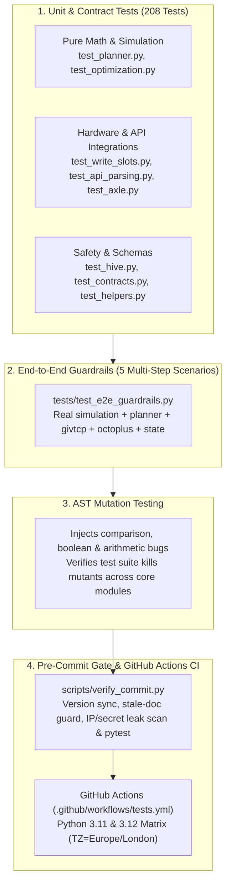
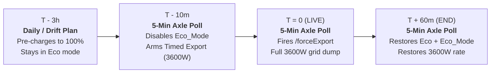

# 🧪 Testing, Guardrails & Quality Assurance Guide

This guide documents the automated testing architecture, end-to-end guardrails, mutation testing benchmarks, and CI/CD quality gates that protect the **GivEnergy Tariff Optimiser** in production.

---

## 🏗️ Testing Pyramid & Verification Pipeline

Every code change passes through four verification layers locally and in GitHub Actions CI before reaching Home Assistant:



---

## 📋 Complete Test Suite Inventory (213 Tests)

| Test File | Focus Area | Key Behaviors Verified |
| :--- | :--- | :--- |
| [`tests/test_e2e_guardrails.py`](../tests/test_e2e_guardrails.py) | **End-to-End Guardrails** | Full multi-step lifecycles across `simulation`, `planner`, `givtcp`, `octoplus`, `axle`, and `state`. |
| [`tests/test_optimization.py`](../tests/test_optimization.py) | **Core Optimization & Monitors** | 24h simulation, winter 100% pre-charge, daytime top-ups, 5-min Axle/Octoplus polling, 30-min SoC drift, composable helpers (`classify_day`, `_clear_axle_state`). |
| [`tests/test_planner.py`](../tests/test_planner.py) | **Cost Search Engine** | Pure side-effect-free `simulate_plan()`, blended normal/pessimistic `score_plan()`, `search_best_plan()`, reserve floor, simultaneous solar + grid charge. |
| [`tests/test_write_slots.py`](../tests/test_write_slots.py) | **GivTCP Hardware Writes** | Charge slot programming, Just-In-Time `Timed Export`, `/setEcoMode`, active `/forceExport`, hardware capability auto-detection (`3,600 W` Hybrid Gen 3). |
| [`tests/test_axle.py`](../tests/test_axle.py) | **Axle Energy VPP** | Token discovery, payload parsing, +1h default end time, 5-minute cache TTL, HA sensor fallback, active & pre-charge window checks. |
| [`tests/test_helpers.py`](../tests/test_helpers.py) | **Octoplus & Rewards** | Power Down / Power Up session matching, adjacent-slot boundaries, `:30` minute & midnight-crossing windows, Wheel of Fortune & scratchcard alerts. |
| [`tests/test_hive.py`](../tests/test_hive.py) | **Hive Hot Water Safety** | Exact `45.0°C` morning shower safety threshold, `15.0 kWh` solar gas-suppression threshold, HA REST HTTP `200`/`500` handling. |
| [`tests/test_api_parsing.py`](../tests/test_api_parsing.py) | **Tariff & Solar APIs** | Octopus Agile & Flux rate parsing, time-of-use Flux Export matching, product code extraction, open-ended `valid_to: None` handling, Forecast.Solar & Open-Meteo parsing. |
| [`tests/test_llm.py`](../tests/test_llm.py) | **ChatGPT AI Strategist** | Candidate selection, negative-rate veto overrides, fail-open fallbacks on API errors, and daily audit summaries. |
| [`tests/test_contracts.py`](../tests/test_contracts.py) | **Pydantic v2 Contracts** | Schema validation for telemetry, rate slots, GivTCP write payloads, LLM decisions, and version sync with `config.yaml`. |
| [`tests/test_config_options.py`](../tests/test_config_options.py) | **App Configuration** | Home Assistant `config.yaml` schema, translations, and runtime environment overrides. |
| [`tests/test_appliance.py`](../tests/test_appliance.py) | **Smart Appliances** | Washing machine smart-plug telemetry tracking and cheapest wash window recommendations. |
| [`tests/test_state_logging.py`](../tests/test_state_logging.py) | **State & NAS History** | JSON state persistence, rolling load profiles, and daily stats archiving. |
| [`tests/test_pre_commit_requirements.py`](../tests/test_pre_commit_requirements.py) | **Release Hygiene** | Automated verification of GPLv3 license headers, AppArmor security profile, and version synchronization. |

---

## 🛡️ End-to-End Guardrail Scenarios (`tests/test_e2e_guardrails.py`)

Each guardrail replays a real-world multi-step production scenario using isolated temporary state files and mocked HTTP endpoints (zero live network calls):



1. **Axle VPP Full Lifecycle**: Verifies the inverter stays in `Eco` mode when an Axle event is >10m away (protecting peak & Power Down windows), disables `Eco_Mode` and arms `Timed Export` at `T-10m` (`3,600 W`), fires `/forceExport` at `T=0`, and restores `Eco` mode + cleans state after the event.
2. **Unbooked vs. Booked Happy Hour Gate**: Verifies unbooked promotional Happy Hours (`is_joined: False`) never trigger daytime grid charging, while booking 1 slot immediately triggers free 100% charging for *only* that hour.
3. **Intraday Power Down Detection + 100% Daytime Top-Up**: Verifies newly detected Power Down sessions trigger a single re-plan (no re-plan loop on subsequent 5m ticks) and allow up to `100%` daytime top-up.
4. **Winter Overnight Pre-Charge + Drift Stability**: Verifies `02:00` 100% off-peak scheduling, `planned_soc_schedule` persistence, and zero false drift re-plans during `run_light_monitor()`.
5. **Negative-Rate / LLM Fail-Open Resilience**: Verifies negative-rate override still enables 100% grid charging even if ChatGPT vetoes or is offline.

---

## 🧬 Mutation Testing Benchmarks

To verify that our tests catch real logic bugs (not just achieve line coverage), we maintain a dedicated AST mutation testing harness ([`scripts/run_mutation_tests.py`](../scripts/run_mutation_tests.py)) that injects comparison (`<` ↔ `<=`, `==` ↔ `!=`), boolean (`and` ↔ `or`), and arithmetic (`+` ↔ `-`) mutants into core decision modules:

| Core Logic Module | Baseline Score | Hardened Score | Key Bugs Guarded Against |
| :--- | :---: | :---: | :--- |
| [`hive.py`](hive.py) | 0.0% (0/3) | **100.0% (3/3)** | Exact 45.0°C shower safety & 15.0 kWh solar thresholds; HA HTTP error handling. |
| [`simulation.py`](simulation.py) *(Flux & off-peak helpers)* | — | **100.0% (3/3)** | Winter full off-peak band detection & per-slot Flux export arbitrage guard. |
| [`octoplus.py`](octoplus.py) *(session matching)* | 38.7% (12/31) | **90.3% (28/31)** | Adjacent-slot overlap boundaries, `:30` minute windows, midnight crossings. |
| [`planner.py`](planner.py) | 53.1% (17/32) | **84.4% (27/32)** | Blended pessimistic weighting formula, reserve floor during force-export, capacity clamping *(100% of non-equivalent mutants killed)*. |
| [`axle.py`](axle.py) | 27.8% (10/36) | **80.6% (29/36)** | Independent enable flags, `+1h` default end time, 5m cache TTL, HA sensor fallback. |
| [`simulation.py`](simulation.py) *(5-min monitors)* | 67.6% (23/34) | **~80%+** | 24h event horizon, end-time extensions, 98% pre-charge boundary, 15m pre-event alerts. |
| [`rewards.py`](rewards.py) | 0.0% (0/2) | **76.5% (13/17)** | HA notification HTTP status, mobile push, GraphQL/HA spin fallbacks, Monday/force gating. |
| [`tariffs.py`](tariffs.py) | 53.1% (17/32) | **~60%+** | 4-part tariff product extraction, single-missing-credential guards, open-ended `valid_to: None` (+24h / 48 slots). |

Run mutation tests locally at any time:
```bash
cd GivEnergy_Tracker
source .venv/bin/activate
python scripts/run_mutation_tests.py --module rewards
python scripts/run_mutation_tests.py --module all
```

---

## 🚀 Running Tests & Pre-Commit Gate Locally

Always activate the project virtual environment before running tests or pre-commit checks:

```bash
cd GivEnergy_Tracker
source .venv/bin/activate

# 1. Run the full automated pre-commit verification gate (version sync, leak check, AppArmor, pytest)
python scripts/verify_commit.py

# 2. Run the full pytest suite with verbose output
pytest -v

# 3. Run only the End-to-End Guardrail suite
pytest tests/test_e2e_guardrails.py -v
```

### Continuous Integration (GitHub Actions)
Every push and pull request to `main` automatically runs [`.github/workflows/tests.yml`](../.github/workflows/tests.yml) across **Python 3.11** and **Python 3.12** under `TZ=Europe/London` (matching the Home Assistant App runtime timezone).
